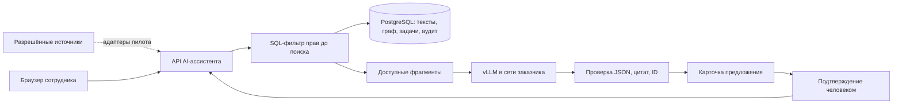

# Развёртывание AI-ассистента в контуре заказчика

Дата проверки документации: 12.11.2026. У заказчика **2×H200 по сообщению
команды**, доступа к ним в этой задаче нет. Этот документ разделяет
имеющийся код и предлагаемый план пилота. Развёртывание на H200,
производительность и качество перечисленных моделей **не проверены**.

## Что уже есть и что предстоит

| Часть | Статус |
|---|---|
| `LLM_PROVIDER=local`, OpenAI-совместимые `/models` и `/chat/completions`, JSON Schema | Реализовано в `backend/app/llm/gateway.py`. Протокол совместимости проверяется тестами; выбранный vLLM на H200 ещё не запускался |
| SQL ACL до поиска, исключение `ai_allowed=false`, participants для переписки, проверка цитат, ActionProposal/подтверждение, аудит | Реализовано и покрыто серверными тестами на синтетическом наборе. Это не сертификация безопасности |
| Импорт `.eml`, Telegram export и JSON рабочих чатов, граф/первоисточники | Реализованы файловые парсеры в `backend/app/connectors/`; это не живые IMAP/Bot API/Битрикс24-интеграции |
| vLLM, модели/драйверы под H200, TLS/секреты, закрытый registry, резервное копирование | План работ администратора и команды пилота |
| Живые коннекторы и синхронизация отзыва прав | План. Потребуют отдельных адаптеров и приёмки, включением URL модели не появляются |
| Корпоративный вход, отключение seed/demo, хранение и аудит по политике заказчика | План подготовки к работе с реальными данными. Текущий демо-вход не заменяет SSO |

## Смена модели без изменения пайплайнов

В демо gateway обращается к Gemini. В контуре тот же gateway обращается
к внутреннему vLLM; поиск, схемы, серверная валидация и подтверждение
действий остаются теми же. Меняется **конфигурация подключения модели**:

```dotenv
LLM_PROVIDER=local
LOCAL_BASE_URL=https://fokus-llm.intra.example/v1
LOCAL_MODEL=fokus-qwen3-32b
LOCAL_API_KEY=<секрет из хранилища заказчика>
GEMINI_API_KEY=
COMPANY_TZ=Europe/Minsk
SCENARIO_NOW=
```

`LOCAL_MODEL` должен точно совпасть с `id` в `/v1/models`. После изменения
настроек пересоздать API: `docker compose up -d --force-recreate api`.
Один лишь `docker compose restart api` не применяет новые environment.
Из API-контейнера адрес должен быть доступен: `localhost` означает сам
контейнер, а не GPU-сервер. Служебный `host.docker.internal` годится для
локальной проверки на Docker Desktop; в пилоте нужен внутренний DNS/маршрут.

Поддержка OpenAI-совместимого API не гарантирует совместимость всех его
реализаций. Нужны `/models`, Chat Completions и именно
`response_format.type=json_schema`. vLLM документирует этот формат,
который использует текущий gateway.
[vLLM: Structured Outputs](https://docs.vllm.ai/en/latest/features/structured_outputs/).

Проверить `/health`: `llm.provider=local`, `route=local`, ожидаемая модель,
`reachable=true`. При ошибке нет автоматического перехода в Gemini.
Для выбранной модели отдельно проверить реальный ответ JSON: список
`/models` сам по себе не доказывает работоспособность генерации.

## Состав и границы контура



В сети заказчика хранятся загруженные копии документов и переписки,
сегменты/индексы, граф, роли/права, черновики, решения, карточки и аудит.
Тексты на инференс получает только внутренний сервер модели. Сотрудник
видит переписку по участию, директор не получает право на чужие письма.
Оклады/ПДн с `ai_allowed=false` не допускаются в AI ни для одной роли.

Это условие требует внутреннего URL модели и контроля исходящего трафика.
Метки `route=local` недостаточно для сетевого доказательства. Приёмка
должна проверить DNS, firewall/egress и отсутствие внешних LLM-запросов.
Модели и образы сначала согласованно загружаются/проверяются и переносятся
в закрытое хранилище; рабочие запросы не требуют скачивания весов извне.

Исходная переписка остаётся в выбранном почтовом/чат-сервисе. Telegram Bot
API обращается к Telegram, а Exchange Online — к Microsoft: локальная LLM
не превращает эти внешние источники в инфраструктуру заказчика. Для полностью
внутреннего источника выбрать внутреннюю почту/коробочный Битрикс24.

Не хранить тела запросов/ответов модели в access-логах reverse proxy или
vLLM. По документации vLLM сбор статистики отключается через
`VLLM_NO_USAGE_STATS=1`; это дополнение к сетевым правилам, а не их замена.
[vLLM: Usage Stats](https://docs.vllm.ai/en/latest/usage/usage_stats/).
Текущий аудит приложения не является неизменяемым WORM-журналом и не
охватывает действия администраторов напрямую в БД; экспорт в SIEM,
retention, шифрование резервных копий и проверка восстановления — план пилота.

## Модели для первого сравнения

Рекомендации ниже — кандидаты для eval на русских документах заказчика,
а не результаты теста. Не выбирать модель только по размеру GPU.
NVIDIA указывает 141 GB памяти у H200; конкретную модификацию, доступную
память и соединение двух карт нужно проверить `nvidia-smi`/`topo -m`.
[NVIDIA H200](https://www.nvidia.com/en-us/data-center/h200/).

| Кандидат | Предлагаемый запуск | Зачем сравнивать и ограничения |
|---|---|---|
| `Qwen/Qwen3-32B` | BF16, сначала 1×H200, контекст 8192, режим без thinking | Основной кандидат. Карточка модели указывает Apache-2.0 и поддержку vLLM. Для фиксированного JSON-пайплайна отключить thinking на сервере, затем проверить все схемы |
| `Qwen/Qwen2.5-32B-Instruct` | BF16, 1×H200, контекст 8192 | Вариант без переключения режима рассуждений для сравнения качества извлечения. Apache-2.0 по карточке; не объявляется лучше Qwen3 без измерения |
| `Qwen/Qwen2.5-72B-Instruct` | BF16, 2×H200, tensor parallel=2 | Более крупный кандидат, только если улучшение качества оправдает ресурсы/задержку. Карточка указывает отдельную лицензию Qwen, поэтому условия использования проверить отдельно |

Источники: [Qwen3-32B](https://huggingface.co/Qwen/Qwen3-32B),
[Qwen2.5-32B-Instruct](https://huggingface.co/Qwen/Qwen2.5-32B-Instruct),
[Qwen2.5-72B-Instruct](https://huggingface.co/Qwen/Qwen2.5-72B-Instruct).
Грубая оценка **только весов**, `число параметров × 2 байта`: около 64–66 GB
для 32B и 144–146 GB для 72B. Это инженерный расчёт, не измеренный расход
VRAM. KV-cache, длина контекста, batch, CUDA graphs и служебные буферы
требуют дополнительной памяти. Нельзя считать память двух GPU единым
пулом без распределения модели. vLLM поддерживает
`--tensor-parallel-size`; проверить топологию и фактический пик под нагрузкой.
[vLLM: Parallelism and Scaling](https://docs.vllm.ai/en/latest/serving/parallelism_scaling/).

Для небольшого пилота 32B на одной H200 оставляет вторую карту для
сравнения/отдельного экземпляра. Автоматическое резервирование этим не
реализовано. Старт с TP=2 на двух H200 тоже возможен как эксперимент,
но выигрыш скорости не гарантирован. Значение выбирается замером.

## Шаблон запуска vLLM — план, на H200 не выполнен

Пример для Linux GPU-хоста. Сначала IT проверяет драйвер/контейнерный
runtime, свободное место, веса и их revision/license/checksum, фиксирует
совместимую версию и digest образа vLLM во внутреннем registry. Ниже
`VLLM_IMAGE` — **реальный согласованный digest**, не строка для копирования
без замены. Не использовать `latest` как зафиксированную конфигурацию пилота.

В `/srv/fokus/vllm.env`, доступном только администратору:

```dotenv
VLLM_API_KEY=<внутренний ключ>
VLLM_NO_USAGE_STATS=1
HF_HUB_OFFLINE=1
TRANSFORMERS_OFFLINE=1
```

Веса уже находятся в `/srv/fokus/models/Qwen3-32B`. Пример:

```bash
docker run -d --name fokus-llm \
  --gpus '"device=0"' --ipc=host \
  --env-file /srv/fokus/vllm.env \
  -p 127.0.0.1:8001:8000 \
  -v /srv/fokus/models:/models:ro \
  "$VLLM_IMAGE" \
  --model /models/Qwen3-32B \
  --served-model-name fokus-qwen3-32b \
  --dtype bfloat16 \
  --tensor-parallel-size 1 \
  --max-model-len 8192 \
  --gpu-memory-utilization 0.85 \
  --default-chat-template-kwargs '{"enable_thinking":false}'
```

Флаг отключения thinking описан в документации vLLM; наличие флага
проверяется `--help` **выбранной версии**, затем smoke по JSON Schema.
Приложение не передаёт специальный `enable_thinking` в OpenAI-вызове, поэтому
это настройка сервера модели.
[vLLM: аргументы сервера](https://docs.vllm.ai/en/latest/api/vllm/entrypoints/common/cli_args/),
[Qwen: vLLM и режимы thinking](https://qwen.readthedocs.io/en/stable/deployment/vllm.html).
Для 72B на двух картах заменить mount/served name/model,
`--gpus '"device=0,1"'` и `--tensor-parallel-size 2`; сначала измерить OOM/пик.

Порт примера слушает только loopback GPU-хоста. Reverse proxy заказчика
на этом хосте завершает TLS и допускает только API-подсеть. Его внутренний
HTTPS-адрес указывается в `LOCAL_BASE_URL`. Публикация порта всему интернету
не нужна. Проверить, что служебная авторизация vLLM работает у выбранной
версии и ключ не попадает в журналы. Токены не передавать в командной строке.

## Коннекторы пилота

| Источник | Уже в прототипе | План подключения и проверки прав |
|---|---|---|
| Почта IMAP / Exchange | Чтение `.eml`, MIME/адресатов/даты и participants | Адаптер IMAP с TLS/OAuth2 либо согласованный Exchange API. Для Exchange Online возможны OAuth IMAP или Graph, для on-prem выбрать поддержанный механизм конкретной версии. Только разрешённые ящики/письма, корректный To/Cc/участники, стабильный Message-ID, дедупликация и отзыв доступа |
| Telegram | Парсер `result.json`, автор/время и участники канала в seed | Отдельный бот только в разрешённых группах, webhook/long polling, защита секрета, сопоставление Telegram ID сотрудникам и изменения членства. Bot API даёт сообщения по режиму privacy/правам бота; полный старый архив автоматически не появляется |
| Битрикс24 | Парсер синтетического JSON чата | REST/OAuth или согласованный webhook с минимальным scope. `im.dialog.messages.get` требует участника чата; членство нужно переносить в ACL AI-ассистента. Проверить edits/deletes, курсор и повторы; чтение чужого чата директором не разрешать |

Точки интеграции подтверждены документацией платформ:
[Microsoft: OAuth для IMAP/SMTP](https://learn.microsoft.com/en-us/exchange/client-developer/legacy-protocols/how-to-authenticate-an-imap-pop-smtp-application-by-using-oauth),
[Exchange Online: application RBAC](https://learn.microsoft.com/en-gb/exchange/permissions-exo/application-rbac),
[Telegram Bots FAQ](https://core.telegram.org/bots/faq),
[Битрикс24: сообщения диалога](https://apidocs.bitrix24.com/api-reference/chats/messages/im-dialog-messages-get.html).
Ни один из этих живых коннекторов в этой ветке не реализуется и не
показывается как подключённый. Синхронизация права должна завершаться до
индексации и удалять утративший доступ контент из поиска/сохранённых ответов.

Рассылка сейчас использует SMTP без `STARTTLS/login` в `mailer.py` и Mailpit
в Compose. Для пилота нужен согласованный внутренний relay и проверка TLS/
аутентификации по требованиям заказчика. Нельзя обещать прямое подключение
к любому Exchange SMTP только сменой адреса. Инференс-переход не меняет код,
а корпоративная доставка/SSO/живые источники — отдельные задачи пилота.

## Приёмка пилота

1. Зафиксировать 2×H200, ОС/драйвер/CUDA, topology, image digest, model
   revision/лицензию, dtype, context, concurrency и настройки сервера.
2. На синтетическом наборе выполнить `/health`, ответ по JSON Schema,
   `eval/run.py --provider local --drafts-ok --include-holdout`; отдельно
   сохранить модель/маршрут, ошибки HTTP, медиану/p95 полного запроса,
   peak VRAM, задачи TP/gold и TP/predicted, статусы и ошибки классификации.
   Не сравнивать условные владельцы/сроки без полноты задач.
3. Две роли и отзыв доступа: поиск, ответ, вьюер, граф, experts и сохранённые
   объекты; forbidden источники/маркеры и ai_allowed=false. HTTP eval не
   видит промпт, поэтому отдельно проверить server-side ACL контекста.
4. Подтверждение/отмена/правка/409 и повтор доставки. Нет исполнения без
   конкретной revision/hash, нет дубликатов встречи или писем при повторе.
5. В закрытой сети подтвердить отсутствие внешнего LLM-трафика, работу
   с выключенным интернетом, недоступность модели без внешнего fallback,
   резервную копию и восстановление, процедуру удаления/retention.
6. Затем ограниченная группа пользователей и согласованные источники.
   Замер времени человеком «вручную / с AI-ассистентом»; пороги качества,
   времени и основания расширения согласовать **до** пилота. Значения
   «экономии времени» до измерений не указывать.

Существующий `docker-compose.yml` — демо-стенд с синтетическим seed,
публичными портами, тестовыми учётками и Mailpit. Его не следует считать
готовой производственной конфигурацией. Эксплуатационный Compose/Helm,
секреты, TLS, backup, SSO и живые коннекторы утверждаются и проверяются
отдельно. Изменение API-контракта для самой смены провайдера не требуется.
